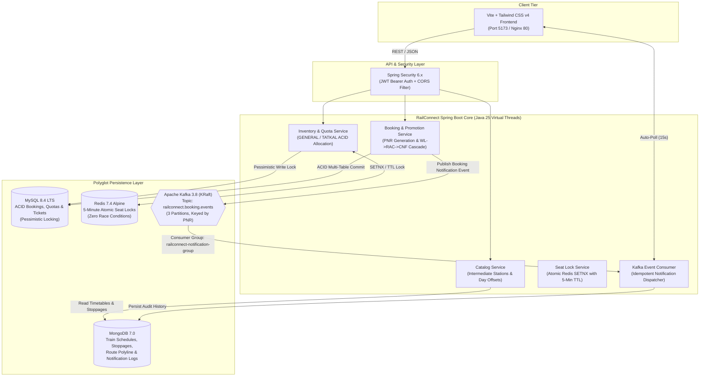

# 🚄 RailConnect — Next-Gen High-Throughput Indian Railways Ticketing Engine

[-ED8B00?style=for-the-badge&logo=openjdk&logoColor=white)](https://openjdk.org/projects/jdk/25/)
[](https://spring.io/projects/spring-boot)
[](https://www.mysql.com/)
[](https://www.mongodb.com/)
[](https://redis.io/)
[](https://kafka.apache.org/)
[](https://vitejs.dev/)
[](https://tailwindcss.com/)
[](https://www.docker.com/)
[](https://testcontainers.com/)

**RailConnect** is an enterprise-grade, high-throughput railway reservation and inventory engine modeled after the core architecture of **Indian Railways (IRCTC / CRIS)**. It replaces legacy, monolithic ticketing bottlenecks with a polyglot, event-driven reactive microservices backend powered by **Java 25 Virtual Threads**, **MySQL 8.4 ACID pessimistic locking**, **MongoDB 7 dynamic schedule trees**, **Redis 7.4 distributed seat locking**, and **Apache Kafka KRaft event pipelines**, paired with a modern dark-mode **Tailwind CSS v4** single-page web application.

---

## 🏛️ System Architecture



---

## ⚡ Core Engineering Highlights

### 1. Hybrid Polyglot Persistence Architecture
* **MySQL 8.4 (ACID Invariants):** Handles users, master passenger lists, daily train quotas, coach seat matrices, and booking ledgers with strict foreign key constraints, unique indexes, and `PESSIMISTIC_WRITE` locking to ensure mathematical inventory consistency under massive burst loads.
* **MongoDB 7.0 (Schedule Flexibility):** Encapsulates rich, hierarchical train schedules, intermediate station arrival/departure arrays, platform numbers, and distance offsets in a single queryable document format with compound indexing.
* **Redis 7.4 (Distributed Atomic Seat Locks):** Implements atomic `SETNX` reservation tokens with a 5-minute time-to-live (`TTL: 300s`). Prevents phantom reads and double bookings while allowing users to pick specific berths before proceeding to payment.
* **Apache Kafka 3.8 KRaft (Event-Driven Reactive Cascades):** Publishes decoupled events (`BOOKING_CONFIRMED`, `BOOKING_CANCELLED`, `PASSENGER_PROMOTED`) partitioned across 3 partitions keyed by `pnrNumber`.

### 2. Intermediate Station & Overnight `dayOffset` Search Engine
Real-world Indian train journeys often run for 24–48 hours across hundreds of stations. RailConnect solves the intermediate station lookup problem:
* Evaluates intermediate boarding and deboarding stops along the train route.
* Accurately factors in station `dayOffset` when searching for trains departing intermediate stations after midnight (e.g., origin departs at 20:00 on Monday, arrives at intermediate junction at 02:30 on Tuesday).

### 3. Dual Status Architecture (Booking vs. Current Status)
Faithfully replicates IRCTC's dual status model:
* **Booking Status:** Captures the permanent, immutable status at the moment of reservation (e.g., `WL/2` or `RAC/4`).
* **Current Live Status:** Dynamically reflects real-time seat promotions (e.g., `CNF/B1/4/LOWER`).

### 4. Automatic Waitlist Cascade Promotion
When a confirmed passenger cancels their reservation:
1. The cancelled passenger's status transitions to `CANCELLED` and a 75% refund is recorded.
2. The freed confirmed seat is automatically assigned to the first eligible `RAC` passenger.
3. The first eligible `WAITLIST` passenger is promoted to `RAC`.
4. A `PASSENGER_PROMOTED` event is broadcast via Kafka to notify the passenger instantly.

### 5. Flight-Style Railway Coach & Berth Picker
* Visual, flight-style layout grouped by coach (`B1`, `B2`, `A1`, `H1`).
* Berths clearly identified by type: `LOWER`, `MIDDLE`, `UPPER`, `SIDE_LOWER`, `SIDE_UPPER`, `WINDOW`, `AISLE`.
* Prominent 5-minute live countdown timer (`04:59`, `04:58`...) with animated lock progress.
* Automatic Redis unlock if the user cancels or closes the window without completing payment.

---

## 🗄️ Database Schemas & Data Model

### MySQL Relational Tables
| Table | Description | Key Constraints & Locks |
|---|---|---|
| `users` | User credentials, roles & profiles | Unique email, unique phone number |
| `saved_passengers` | Master passenger list for 1-click autofill | Foreign key to `users(id)` |
| `daily_train_quotas` | Quota ledger per train, date, class & quota | Unique: `(train, date, class, quota)`, Pessimistic Lock |
| `coach_seats` | Physical seat status per coach and date | Unique: `(train, date, class, coach, seat)` |
| `bookings` | Master booking reservation record | Unique 10-Digit `pnr_number`, index on `user_id` |
| `booked_passengers` | Individual passenger tickets & allocations | Dual status: `booking_status` & `current_status` |
| `payment_transactions` | Payment audit trail & refund receipts | Unique `transaction_reference` |

### MongoDB Collections
* **`train_schedules`**: Stores train metadata, weekly running days, coach compositions, and intermediate station stoppage timelines.
* **`notification_logs`**: Stores consumed Kafka events, recipient details, read statuses, and dispatch timestamps.

---

## 🚀 Complete REST API Reference

### 1. Catalog & Timetable API
| Method | Endpoint | Description |
|---|---|---|
| `GET` | `/api/v1/catalog/stations/search?q={query}` | Debounced station autocomplete |
| `GET` | `/api/v1/catalog/trains/search?from={from}&to={to}&date={date}` | Multi-stop train search with `dayOffset` |
| `GET` | `/api/v1/catalog/trains/{trainNumber}` | Full timetable with intermediate stops |

### 2. Authentication & Master Passenger API
| Method | Endpoint | Description |
|---|---|---|
| `POST` | `/api/v1/auth/register` | Register user with 10-digit mobile & strong password |
| `POST` | `/api/v1/auth/login` | Sign in and obtain JWT Bearer Token |
| `GET` | `/api/v1/users/me/passengers` | Retrieve saved master passenger list |
| `POST` | `/api/v1/users/me/passengers` | Add traveler with preferred berth & senior citizen opt-in |
| `DELETE` | `/api/v1/users/me/passengers/{id}` | Delete saved traveler from master list |

### 3. Inventory & Seat Locking API
| Method | Endpoint | Description |
|---|---|---|
| `GET` | `/api/v1/inventory/trains/{trainNumber}/availability?date={date}` | Live availability across all classes & quotas |
| `GET` | `/api/v1/inventory/trains/{trainNumber}/seats?date={date}&classCode={class}` | Retrieve physical coach layout & lock states |
| `POST` | `/api/v1/inventory/seats/lock` | Atomically lock specific seat via Redis (5-min TTL) |
| `POST` | `/api/v1/inventory/seats/unlock` | Explicitly release locked seat |

### 4. Booking, E-Ticket & Cancellation API
| Method | Endpoint | Description |
|---|---|---|
| `POST` | `/api/v1/bookings` | Execute ACID booking with seat allocation & PNR creation |
| `GET` | `/api/v1/bookings/pnr/{pnrNumber}` | Public PNR status inquiry |
| `GET` | `/api/v1/bookings/my` | Retrieve authenticated user's travel history |
| `POST` | `/api/v1/bookings/{pnrNumber}/cancel` | Cancel booking, issue 75% refund, and trigger cascade |

### 5. Notifications & System Health API
| Method | Endpoint | Description |
|---|---|---|
| `GET` | `/api/v1/notifications/my` | Fetch real-time Kafka notifications |
| `PATCH` | `/api/v1/notifications/{id}/read` | Mark notification as read |
| `GET` | `/api/v1/system/status` | Live infrastructure healthcheck (MySQL, Mongo, Redis, Kafka) |

---

## 🛠️ Getting Started & Local Development

### Prerequisites
* **JDK 25** (e.g. Eclipse Temurin 25 or Microsoft OpenJDK 25)
* **Node.js 22+** & **npm**
* **Docker & Docker Compose**

### Option A: Local Development with IDE
1. **Start the Infrastructure Containers:**
   ```bash
   docker compose up -d mysql mongodb redis kafka
   ```
2. **Start the Spring Boot Backend:**
   ```bash
   ./mvnw spring-boot:run
   ```
   *The backend will boot on `http://localhost:8080`.*
3. **Start the Vite Frontend:**
   ```bash
   cd frontend
   npm install
   npm run dev
   ```
   *Open `http://localhost:5173` in your browser.*

---

### Option B: Full-Stack Containerized Execution
To run the entire ecosystem (Databases, Message Broker, Spring Boot Core, and Nginx Frontend) in Docker:
```bash
docker compose up --build -d
```
* **Frontend Application:** `http://localhost:5173`
* **Backend REST API:** `http://localhost:8080`
* **Health Check Endpoint:** `http://localhost:8080/api/v1/system/status`

To gracefully shut down:
```bash
docker compose down
```

---

## 🧪 Automated Testing & Testcontainers Suite

RailConnect includes **41 enterprise integration tests** executed against live containerized databases using **Testcontainers**.

```bash
./mvnw clean test
```

### Verified Test Matrix:
* ✅ `CatalogIntegrationTest`: Intermediate station search, running day matching, day offset validation.
* ✅ `DailyTrainQuotaRepositoryTest`: Pessimistic lock verification under concurrent read/write queries.
* ✅ `InventoryServiceIntegrationTest`: Dynamic seat generation directly from train schedule JSON configuration.
* ✅ `SeatLockConcurrencyIntegrationTest`: Redis atomic `SETNX` race condition verification under parallel threads.
* ✅ `BookingIntegrationTest`: End-to-end ACID booking, PNR generation, and berth allocation.
* ✅ `TatkalWindowIntegrationTest`: Enforcing IRCTC 10:00 AM AC / 11:00 AM Non-AC Tatkal advance reservation limits.
* ✅ `WaitlistPromotionIntegrationTest`: Validating automated `WL -> RAC -> CNF` cascade on ticket cancellation.
* ✅ `NotificationEventIntegrationTest`: Verifying Kafka producer and idempotent consumer processing.

---

## 🛡️ Security, Reliability & Compliance
* **JWT Stateless Authentication:** Tokens signed with HMAC-SHA256, validating user identity and roles across requests.
* **CORS Protection:** Configured with explicit origin allowances (`localhost:5173`, `127.0.0.1:5173`, `localhost:3000`) and credential support.
* **Non-Root Container Execution:** Docker runtime images execute under an isolated system user (`railconnect`).
* **Input Validation:** Strict Jakarta Bean Validation on all DTOs (e.g., regex checks on Indian 10-digit mobile numbers `^[6-9]\d{9}$`).

---

## 📜 License
Distributed under the **MIT License**.
Built with precision for high-concurrency railway operations.
